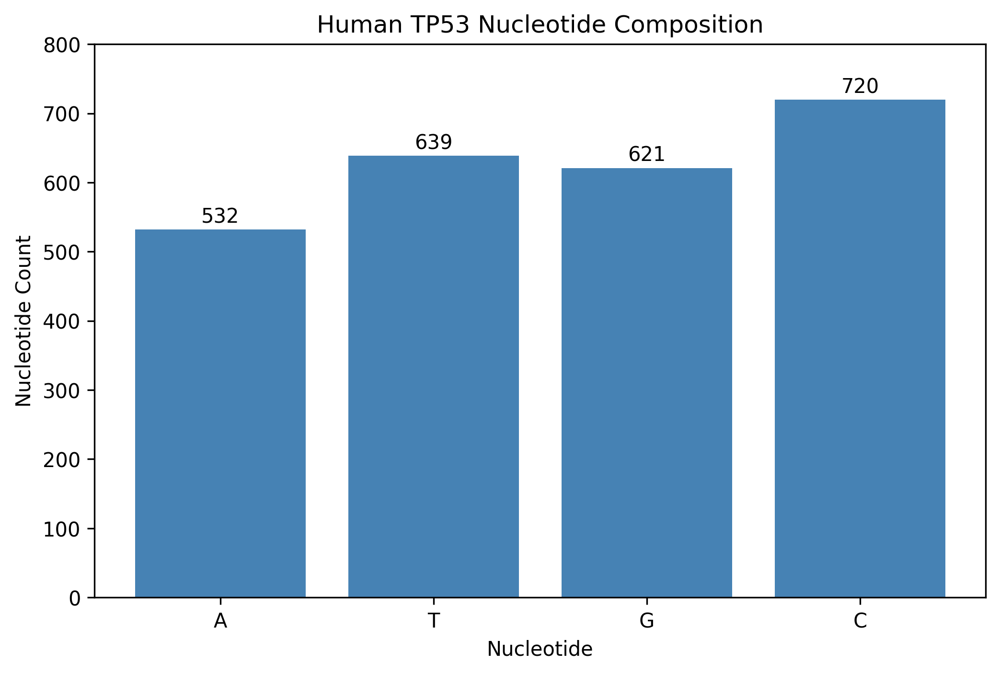
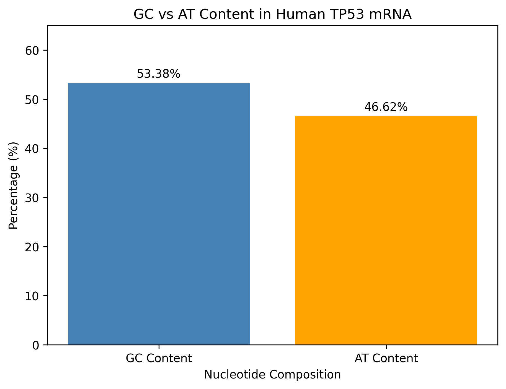
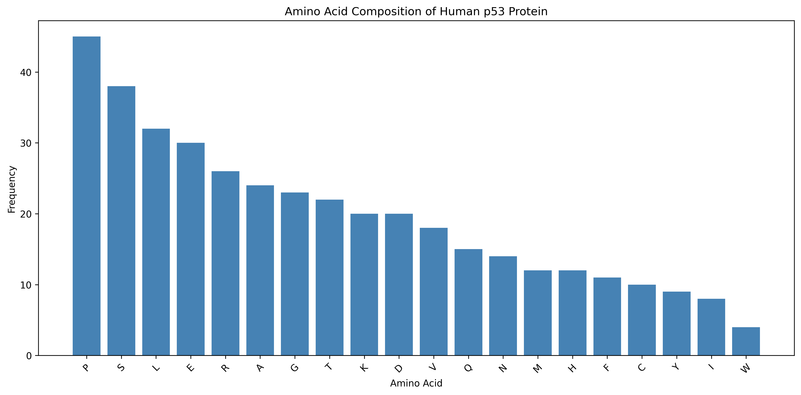

# Human TP53 mRNA and Protein Sequence Analysis

## Project Overview

This project demonstrates a bioinformatics workflow for analyzing the human **TP53 reference mRNA transcript** and its corresponding p53 protein using Python, Biopython, pandas, and Matplotlib.

The analysis uses publicly available reference sequences from the National Center for Biotechnology Information (NCBI).

The project was developed in Google Colab to practice biological sequence retrieval, FASTA and GenBank processing, nucleotide composition analysis, protein translation, visualization, and reference sequence validation.

## Objectives

- Retrieve a human TP53 reference transcript from NCBI.
- Calculate nucleotide frequencies, GC content, and AT content.
- Visualize nucleotide composition using Python.
- Identify the annotated protein-coding sequence (CDS).
- Translate the coding sequence into the p53 protein.
- Analyze amino acid composition.
- Compare the translated protein with the NCBI reference sequence.
- Export analysis results in CSV, FASTA, PNG, and TXT formats.

## Data Sources

| Reference | NCBI Accession | Description |
|---|---|---|
| TP53 mRNA | NM_000546.6 | Human TP53 reference transcript |
| p53 protein | NP_000537.3 | Human p53 reference protein |

**Source:** NCBI RefSeq database.

## Tools and Technologies

- Python
- Biopython
- pandas
- Matplotlib
- Google Colab
- NCBI Entrez
- GitHub

## Analysis Workflow

1. Retrieved the human TP53 reference transcript using Biopython Entrez.
2. Calculated nucleotide counts and GC/AT percentages.
3. Created nucleotide composition and GC-versus-AT graphs.
4. Downloaded the GenBank record and extracted the annotated CDS.
5. Translated the CDS into the p53 amino acid sequence.
6. Calculated amino acid frequencies and visualized their distribution.
7. Downloaded the corresponding NCBI reference protein.
8. Compared the translated protein with the reference sequence.
9. Exported the results for documentation and reproducibility.

## Results

### Nucleotide Composition

The analyzed TP53 reference transcript contains **2,512 nucleotides**.

| Nucleotide | Count | Percentage |
|---|---:|---:|
| Adenine (A) | 532 | 21.18% |
| Thymine (T) | 639 | 25.44% |
| Guanine (G) | 621 | 24.72% |
| Cytosine (C) | 720 | 28.66% |

**GC Content:** 53.38%

**AT Content:** 46.62%

**GC-to-AT Ratio:** 1.145

### Protein Analysis

- Coding sequence length: 1,182 nucleotides, including the stop codon
- Translated protein length: 393 amino acids
- Reference protein accession: NP_000537.3

### Protein Sequence Validation

The translated p53 protein was compared against the NCBI reference protein.

**Validation result: Exact sequence match (True)**

Both sequences contained 393 amino acids.

## Visualizations

### Nucleotide Composition

### GC vs AT Content

### Amino Acid Composition

## Project Files

| File | Description |
|---|---|
| TP53_Gene_Sequence_Analysis.ipynb | Google Colab Python analysis notebook |
| TP53_Human_Sequence.fasta | Human TP53 reference transcript |
| TP53_Protein_Sequence.fasta | Translated p53 protein |
| TP53_Nucleotide_Analysis.csv | Nucleotide counts and percentages |
| TP53_Amino_Acid_Composition.csv | Amino acid frequency table |
| TP53_Nucleotide_Composition.png | Nucleotide composition graph |
| TP53_GC_AT_Comparison.png | GC and AT content comparison |
| TP53_Amino_Acid_Composition.png | Amino acid composition graph |
| TP53_Complete_Analysis_Report.txt | Complete analysis summary |

## How to Run

1. Open `TP53_Gene_Sequence_Analysis.ipynb` in Google Colab.
2. Install Biopython if necessary:

   `!pip install biopython`

3. Run the notebook cells in order.
4. An internet connection is required to retrieve NCBI reference sequences.
5. Review the generated FASTA, CSV, PNG, and TXT files.

## Conclusion

This project demonstrates foundational bioinformatics skills in biological database retrieval, sequence processing, nucleotide and amino acid composition analysis, coding sequence extraction, protein translation, and reference validation.

The workflow uses a real human TP53 reference transcript and demonstrates how Python can be applied to reproducible biological sequence analysis.

**Note:** This is an educational analysis of a reference transcript, not a clinical interpretation of TP53 mutations or cancer risk.
